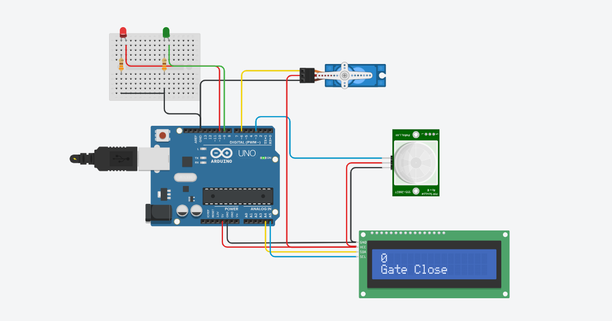
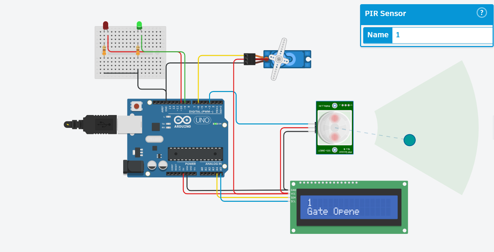

# pir-motion-sensor
# automatic-door-closer

An intelligent, automated door control system powered by an Arduino Uno, a PIR motion sensor for human detection, and an LCD status display.

## Overview

This project automates door operation by detecting when someone approaches. When the PIR motion sensor senses a body, the Arduino instantly updates the LCD screen to show a detection status message and triggers the door mechanism to open.

## Features

* **Infrared Motion Tracking:** Uses a Passive Infrared (PIR) sensor to detect human presence without physical contact.
* **Live LCD Status Display:** Renders real-time system states (e.g., "Body is detected") on a 16x2 character LCD screen[cite: 3].
* **Automated Control:** Seamlessly coordinates sensor inputs and output actuators via an Arduino Uno microcontroller[cite: 3].

## Hardware Requirements

* Arduino Uno microcontroller[cite: 3]
* PIR Motion Sensor[cite: 3]
* 16x2 Character LCD Module[cite: 3]
* Servo motor or door actuation mechanism
* Breadboard and jumper wires[cite: 3]

## How It Works in This Project

1. **Resting State:** The door remains closed, and the PIR sensor continuously scans its field of view for changes in infrared heat signatures (body heat).
2. **Motion Trigger:** When a person approaches the door, the PIR sensor detects their thermal radiation and sends a digital `HIGH` signal to the Arduino.
3. **Display Update:** The Arduino processes the signal and updates the LCD screen to display a notification like **"Body is detected"**[cite: 3].
4. **Door Action:** Simultaneously, the microcontroller triggers the mechanical system (like a servo motor) to open the door, keeping it open while motion is present before automatically closing it again.
